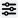

# Character Sheet Overview

In GCS, the **character sheet** is where you add your traits, skills, spells, equipment, and other information from the
[Library Explorer](Library%20Explorer) when building your GURPS character ([B10](B10)).

See [Create your first character](Create%20your%20first%20character) for a step-by-step guide in building a character
without overwhelming you with details.

## Creating a character sheet

- Select **File > New > New Character Sheet**. You can also press `Ctrl+N` (or `Cmd+N` on macOS) on your keyboard.

A blank character sheet opens with defaults:

- A randomly generated name and description
- All primary attributes set to 10
- A humanoid body type
- The Bite, Kick, and Punch natural attacks
- 150 unspent character points (your starting points).

You can change these defaults in [General Settings](General%20Settings) and [Default Settings](Default%20Settings).

> [!TIP]
> To start from a [character template](Character%20Templates) instead, select the template in the Library Explorer,
> right-click it, and choose **New Character Sheet from Template**.

## Opening a character sheet

- **From the User Library:** Double-click the sheet in the [Library Explorer](Library%20Explorer).
- **From another location:** Select **File > Open** (`Ctrl+O` / `Cmd+O`), browse to the file, and select **Open**.
  You can also drop a file onto the GCS window.

## Saving a character sheet

To save your work:

- **Save:** Select **File > Save** (`Ctrl+S` / `Cmd+S`).
- **Save As:** Select **File > Save As** (`Ctrl+Shift+S` / `Cmd+Shift+S`).

> [!NOTE]
> An asterisk (`*`) on the tab means the sheet has unsaved changes.

## Exporting a character sheet

- Select **File > Export**, then choose a format:
  - **PDF** (printable sheets, `Ctrl+Shift+P` / `Cmd+Shift+P`)
  - **WEBP**, **PNG**, or **JPEG** (images, at the resolution set in [General Settings](General%20Settings))
  - **Export Portrait** (saves the portrait image on its own)
  - The text export templates found in your libraries, such as **Fantasy Grounds**, **HTML**, **Text**, and
    **Obsidian Markdown** from the Master Library. See [Export Templates](Export%20Templates) to write your own.

## Printing a character sheet

- Select **File > Print** (`Ctrl+P` / `Cmd+P`), choose your printer and settings, then select **Print**.

The paper size, orientation, and margins come from the sheet's [Sheet Settings](Sheet%20Settings). A block that
doesn't fit in the space left on a page is moved whole to the next page, while lists are split across pages.

## Character sheet blocks

Your character sheet in GCS is divided into blocks, each focusing on a specific part of your character. These blocks
update automatically as you add or change content, so you don’t have to calculate everything by hand.

The table below gives an overview of each block. You can click through to individual pages for a deeper dive into how
each one works.

| Block                                | Description                                                                                                                                                                                                                                                      |
|--------------------------------------|------------------------------------------------------------------------------------------------------------------------------------------------------------------------------------------------------------------------------------------------------------------|
| **Portrait**                         | Add an image for your character. Drop an image file, image data, or a web link onto it, or double-click it (or press `Space` while it has the focus) to choose a file. The image is stored at up to 400 pixels on a side.                                        |
| **Identity**                         | Holds your character’s name, title, and organization.                                                                                                                                                                                                            |
| **Description**                      | Gender, age, birthday, religion, height, weight, size, tech level ([B22](B22)), hair, eyes, skin, and handedness. Select **Randomize**  beside a field to generate a random entry from the character's ancestry.       |
| **Miscellaneous**                    | Shows the created and modified dates and the player’s name.                                                                                                                                                                                                      |
| **Points**                           | Tracks your [character points](Character%20Points), with a breakdown by ancestry, attributes, advantages, disadvantages, quirks, skills, and spells.                                                                                                              |
| **Primary and Secondary Attributes** | Shows your basic attributes and secondary characteristics. Hover over one to see where its bonuses come from. See [Attributes](Attributes) for details.                                                                                                          |
| **Point Pools**                      | Tracks your fatigue points (FP), hit points (HP), and other pools. See [Point pools](Point%20pools).                                                                                                                                                              |
| **Body Type**                        | Titled with your [body type](Body%20type), such as _Humanoid_. Displays the hit location table with damage resistance (DR) and a space for notes  for each location (for example, “crippled”).                        |
| **Encumbrance, Move & Dodge**        | Shows encumbrance and movement speeds. The weight icon  indicates your current encumbrance level.                                                                                                                          |
| **Lifting & Moving Things**          | Calculates how much weight your character can lift and carry.                                                                                                                                                                                                    |
| **Basic Damage**                     | Lists thrust and swing damage based on ST.                                                                                                                                                                                                                       |
| **Reaction Modifiers**               | Appears only if traits, skills, or equipment give your character reaction modifiers.                                                                                                                                                                             |
| **Conditional Modifiers**            | Appears only if traits, skills, or equipment give your character conditional modifiers.                                                                                                                                                                          |
| **Melee Attacks**                    | Lists your melee attacks, from equipped weapons, traits, skills, and spells, with their stats. See [Melee and Ranged Weapons](Melee%20and%20Ranged%20Weapons).                                                                                                    |
| **Ranged Attacks**                   | Lists your ranged attacks with their stats. See [Melee and Ranged Weapons](Melee%20and%20Ranged%20Weapons).                                                                                                                                                       |
| **Traits**                           | Shows your advantages, disadvantages, and quirks. See [Traits](Traits).                                                                                                                                                                                          |
| **Skills**                           | Lists your character’s skills and techniques. See [Skills](Skills).                                                                                                                                                                                              |
| **Spells**                           | Lists spells your character knows. See [Spells](Spells).                                                                                                                                                                                                         |
| **Carried Equipment**                | Tracks the equipment your character carries. Carried items can be equipped and affect encumbrance. See [Equipment](Equipment).                                                                                                                                   |
| **Other Equipment**                  | Tracks equipment your character owns but isn't carrying. See [Equipment](Equipment).                                                                                                                                                                             |
| **Notes**                            | Free-form notes for backstory, reminders, or campaign info. See [Notes](Notes).                                                                                                                                                                                  |

## Sheet layout

You can rearrange, resize, and hide the blocks directly on the sheet.

1. Select **Edit Layout**  on the character sheet toolbar, or go to **Sheet >
   Edit Sheet Layout**. Each block gets a dashed outline.
2. Make your changes:
   - **Move a block:** Drag it to place it beside, above, or below another block, or drop it on the seam between two
     blocks to sit alongside both of them.
   - **Share the width:** Drag the divider between side-by-side blocks.
   - **Set a minimum height:** Drag a block's bottom edge down. Drag it back up to let the block size itself again.
   - **Hide a block:** Select the **×** in its top-right corner, or right-click it and choose **Hide**. The Portrait
     block has a second button beside the **×** that makes its picture area square.
3. Select **Edit Layout** again, or press `Escape`, to finish. Pressing `Escape` during a drag abandons the drag.

Layout changes can be undone with **Edit > Undo** like any other edit to the sheet. The **Block layout menu**
 beside the Edit Layout button holds the remaining layout commands:

- **Show:** Bring a hidden block back. It returns at the bottom of the sheet.
- **Use This Layout as the Default for New Sheets:** Make this sheet's arrangement the default. Templates use the
  default layout too.
- **Reset Layout to Default:** Put this sheet back to the default arrangement.
- **Reset the Default Layout to Factory Settings:** Restore the default arrangement that GCS ships with. This sheet is
  left as it is.

> [!NOTE]
> The Reaction Modifiers, Conditional Modifiers, Melee Attacks, and Ranged Attacks blocks are left off the sheet while
> they are empty, so they can't be moved until something fills them.

## Master Library Syncing

GCS tracks whether items on your character sheet match the library they came from, such as the official **Master
Library**. Look for the **Library Source** column  next to items on your sheet.

| Marker  | Meaning                                                                                                                            |
|---------|------------------------------------------------------------------------------------------------------------------------------------|
| (blank) | Matches the library.                                                                                                               |
| `!`     | Different from the library. This happens if you edited the item or if the library was updated (for example, a bug fix).           |
| `—`     | Custom item that didn’t come from a library.                                                                                       |
| `?`     | The library the item came from can't be found, so it can't be compared.                                                            |
| `≠`     | The item is of a different kind than its source (for example, a trait whose source is now a container), so it can't be synced.     |

Hover over the marker to see the item's source. You can hide this column in [Sheet Settings](Sheet%20Settings).

### Syncing items

By default, changes in the Master Library don’t affect your sheet. To update your sheet so it matches the library, you
can resync:

- **Sync a single item:** Right-click the item and select **Sync with Source**, or select it and go to **Item > Sync
  with Source**. In the item's editor, the same command is on the **ID & Library Source**
   toolbar button.
- **Sync everything at once:** Select **Sync with all sources in this sheet**  in the character sheet toolbar.
- **Break the link:** Select **Item > Clear Source** to turn an item into a custom item that is never synced.

> [!CAUTION]
> If you intentionally customized an item (for example, modified a skill or piece of equipment), don’t resync it or it
> will overwrite your changes.

## Character sheet toolbar

The toolbar above the character sheet gives you quick access to common actions:

| Button                                                | Name                                            | Description                                                                                                                                                                      |
|:------------------------------------------------------|-------------------------------------------------|----------------------------------------------------------------------------------------------------------------------------------------------------------------------------------|
|                     | **Info**                                        | Hover to see a reminder that holding `Alt` (`Option` on macOS) while using the mouse wheel changes the scale.                                                                     |
|                     | **Help**                                        | Open this page from the User Guide.                                                                                                                                              |
| 100%                                                  | **Scale**                                       | Adjust the display size of your character sheet.                                                                                                                                 |
|       | **Opens/closes all hierarchical rows**          | Show or hide all items within containers at once.                                                                                                                                |
|   | **Opens/closes all embedded notes**             | Show or hide all embedded notes on your sheet.                                                                                                                                   |
|  | **Sheet Settings**                              | Change settings for your character sheet. See [Sheet Settings](Sheet%20Settings).                                                                                                |
|         | **Attributes**                                  | Change your Primary and Secondary [Attributes](Attributes) and [Point pools](Point%20pools).                                                                                      |
|            | **Body Type**                                   | Edit your character's [Body type](Body%20type).                                                                                                                                  |
|            | **Edit the sheet's block layout**               | Rearrange the blocks on the sheet. See **Sheet layout** above.                                                                                                                   |
|        | **Block layout menu**                           | Show hidden blocks, reset the layout, or make this layout the default.                                                                                                           |
|                   | **Clone Character Sheet & Re-Randomize Fields** | Creates an exact copy of your character sheet, with randomized description fields.                                                                                               |
|      | **Sync with all sources in this sheet**         | Sync all items on the character sheet with the libraries they came from.                                                                                                         |
|         | **Calculators**                                 | Open the [calculators](Calculator) for explosions, scatter, demolition, collisions and falls, jumping, throwing, and hiking.                                                     |
|  | **Shopping Record**                             | Open the record of what the character has bought and sold. See [Equipment](Equipment).                                                                                           |
| N/A                                                   | **Search**                                      | Type to list the matching rows on the sheet, with the name of the list each is in. Choose one with a click, or with the arrow keys and `Return`, to select it and scroll to it.  |

> [!TIP]
> Press `Ctrl+J` (`Cmd+J` on macOS) to jump to the search field. When the window is narrow, the toolbar wraps onto more
> rows.

> [!NOTE]
> If a **Data never settles** notice appears after the search field, the sheet's prerequisites, defaults, features, or
> scripts depend on one another in a circle, so no state satisfies all of them at once. Hover over the notice for
> details and look for what refers back to itself.

---

[Return to Home](Home)
