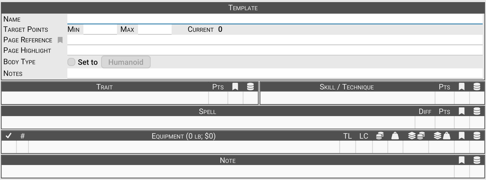

# Character Templates

Character templates ([B258](B258)) are **collections of elements** that you can apply to your [character
sheet](Character%20Sheet%20Overview). They make it easy to build consistent characters quickly, enforce choices, and
bundle common options.

Templates can represent:

- Races (Elf, Dwarf).
- Professions or training packages (Knight, Soldier, Wizard).
- Gear sets (Adventurer’s Pack).
- Grimoires or spellbooks.
- Custom bundles of [Traits](Traits), [Skills](Skills), [Spells](Spells), [Equipment](Equipment), and [Notes](Notes).

When you apply a template to a character, its contents (including spent points) are copied into the character sheet. If
the template has **choices**, **modifiers** to pick, or **substitutions** to fill in, GCS walks you through them first,
in that order, and then asks about any ancestry it adds. Canceling any of the questions leaves the sheet as it was, and
the whole application is a single undoable step.

## Creating a template

To build a new template:

1. Go to **File > New > New Character Template**.
2. Fill in the **Template** block at the top:
   - **Name:** The template's name. An unsaved template takes its tab title from it.
   - **Target Points:** What the template is meant to cost. Enter a **Min**, a **Max**, or both; enter the same value
     in both for an exact target. **Current** shows what the template's traits, skills, and spells cost, as a range
     while choices remain unmade, in the error color when the cost can fall outside the target.
   - **Page Reference** and **Page Highlight:** Where the template is published. See [Page
     References](Page%20References).
   - **Body Type:** Check **Set to** and select the body type button to give characters built from the template a
     [body type](Body%20type) other than humanoid.
   - **Notes:** Instructions or background for the template, shown at the top of the template.
3. Add [Traits](Traits), [Skills](Skills), [Spells](Spells), [Equipment](Equipment), and [Notes](Notes) by dragging
   them from libraries, or with **Copy to Template** from a library's right-click menu. Adding an item prompts for its
   modifiers and substitutions, just as adding it to a sheet does.
4. Add or adjust [Trait Modifiers](Trait%20Modifiers) or [Equipment Modifiers](Equipment%20Modifiers), if needed.
5. Save your template for future use.

> [!TIP]
> Test new templates on a blank character sheet before applying them to an active character. **Sheet > New Character
> Sheet from Template** creates one for you, starting the character at the template's target points when the target is
> exact.

## Using choices in templates

A **choice** is a special kind of [container](Containers) that asks the player to pick from its contents when the
template is applied. Choices give templates much of their power.

To add a choice, go to **Insert > Trait > New Trait Choice** (or the **Skill**, **Spell**, or **Equipment** equivalent),
right-click a list and select **New Choice**, or select a container and choose **Item > Convert > Convert to Choice**.
The choice's **Choices** row sets its rule:

- **Count:** The player must pick a number of items.
- **Points:** The player's picks must total a point value (traits, skills, and spells).
- **Value** or **Weight:** The player's picks must total a money value or a weight (equipment).

The rule shows after the choice's name on the template, such as _Pick 1_ or _Pick 20 points worth_, and the template's
points column shows what the choice may come to, as a range such as `20~45` while the picks are open.

When you apply the template, GCS presents a picker for each choice:

- Check the options you want. The running total at the top shows what the picks come to against the rule, and a note
  under the list says what is left to do.
- A container inside a choice is picked as a unit, and can be opened to show what it holds. To offer its contents one
  by one instead, clear **Picked as a Unit** in the container's editor.
- A choice inside a choice, or an option whose modifiers must be chosen, has a button beside it that opens that
  question right away, so its cost is fixed. Options still waiting on a choice show a range.
- **OK** is enabled once the rule is met. **Override** accepts the picks anyway, leaving any open questions for when
  the template is applied.

Only a template can hold choices: copying a choice to a character sheet makes the choice on the way, so only the picked
options arrive.

## Best practices for templates

To make your character templates more usable and consistent:

- **One top-level container:** Put everything in a single, clearly named [container](Containers) (for example, _Dwarf_,
  _Knight_, _Adventurer’s Pack_).
- **Set the target points:** Fill in **Target Points** so the template checks its own cost.
- **Always add [Page References](Page%20References)** for published content (at least in the Template block).
- **Guide choices with choice containers:** Use **Count** or **Points** to enforce “pick X skills” or “spend X points.”
- **Organize professions:** Group skills into **Primary**, **Secondary**, and **Background** sub-containers.
- **Separate attributes:** Place traits like _Increased ST_ inside a container with **Container Type = Attributes** so
  points apply correctly.
- **Use an Ancestry container for races:** Set its **Container Type** to **Ancestry** and choose the ancestry so the
  character's random name, height, and weight follow it.
- **Clean up modifiers:** Remove irrelevant trait modifiers (for example, don’t leave _No Fine Manipulators_ on a
  humanoid ancestry).
- **Set the body type for character builds:** Make sure the correct **Body Type** is set in the Template block.

These practices help enforce rules without overwhelming players with confusing errors or irrelevant options.

## Substitutions

Templates can also include [substitution **placeholders**](Substitutions) using the **`@Code@`** format.

- When the template is applied, GCS prompts for each placeholder that has no value yet.
- The answer replaces the placeholder wherever it appears (commonly in fields like skill specialization).

## Modifiers in templates

When you add an item with modifiers to a template, GCS asks about them right away, just as it does for a sheet, and the
answers are kept with the template.

- Check **Preconfigured** in the item's editor once its modifiers and substitutions are the way the template should
  always have them. GCS then doesn't ask about them again when the template is applied, except for a mandatory modifier
  choice that still has no pick or a placeholder that still has no value.
- Leave it unchecked for items the player should decide about. The template's answers are then only defaults, and the
  cost of such an item shows as a range until it reaches a sheet.

See [Substitutions](Substitutions) for details.

## Applying a template

- Open the template and select **Apply Template to Character Sheet**  on its toolbar (`Ctrl+Shift+A` / `Cmd+Shift+A`), or right-click the
  template in the Library Explorer and choose the same command. If more than one character sheet is open, you'll be
  prompted to choose which to apply it to.
- Or right-click the template in the Library Explorer and choose **New Character Sheet from Template** to start a new
  character from it.

Skills and spells the character already has gain the template's points rather than being added twice. If the template
adds an ancestry and the character already has one, GCS asks whether to disable the existing ancestry and offers to
randomize the character's description again.

## Character template toolbar

The toolbar above a character template gives you quick access to common actions:

| Button                                                | Name                                    | Description                                                                                                                                                                                   |
|:------------------------------------------------------|-----------------------------------------|-----------------------------------------------------------------------------------------------------------------------------------------------------------------------------------------------|
|                     | **Help**                                | Opens this page from the User Guide.                                                                                                                                                          |
| 100%                                                  | **Scale**                               | Adjusts the display size of the character template.                                                                                                                                           |
|       | **Opens/closes all hierarchical rows**  | Show or hide all items within containers at once.                                                                                                                                             |
|   | **Opens/closes all embedded notes**     | Show or hide all embedded notes on your template.                                                                                                                                             |
|  | **Apply Template to Character Sheet**   | Copies the contents of the current template to an open [character sheet](Character%20Sheet%20Overview). If more than one character sheet is open, you'll be prompted to choose which to apply to. |
|      | **Sync with all sources in this sheet** | Sync all items in the character template with the libraries they came from.                                                                                                                   |
| N/A                                                   | **Search**                              | Type to list the matching rows in the template. Choose one to select it and scroll to it.                                                                                                      |

---

[Return to Home](Home)
