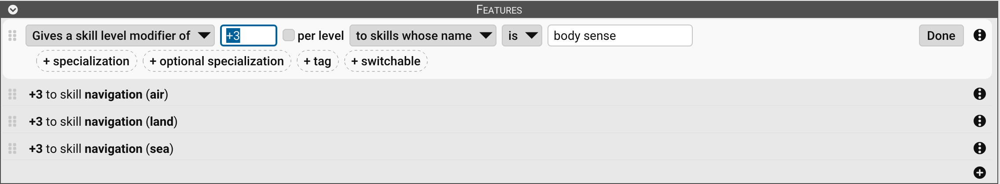

# Features

Features appear in the **Detail Editor** of [Traits](Traits), [Skills](Skills), [Spells](Spells), [Equipment](Equipment),
[Trait Modifiers](Trait%20Modifiers), and [Equipment Modifiers](Equipment%20Modifiers) and provide your character with
specific benefits. They’re different from [Prerequisites](Prerequisites):

- **Prerequisites** determine _who can take_ something.
- **Features** determine _what it does_ once you have it.

Features are edited directly in the **Detail Editor** under the **Features** section.

## The Features section

The **Features** section lists each feature as a line of plain text, such as _+1 to attribute ST per level_. Select the
section's title to collapse it to a one-paragraph summary, or to expand it again.

- **Editing:** Select a feature to open it. Its controls read as a sentence: choose the feature type from the first
  dropdown, then fill in the amount and the fields that follow. Select **Done** (or press `Return` or `Escape`) to
  close it.
- **Chips:** Optional criteria are added as chips. Select a dashed **+ …** button to add one, and the **x** on a chip to
  remove it.
- **Reordering:** Drag a feature by its grip  to move it. Dragging it into the
  Features section of another open editor copies it there.
- **More actions:** Select **More actions**  beside a feature for
  **Duplicate**, **Move Up**, **Move Down**, and **Delete**.

Every change can be undone with **Edit > Undo**.

## Adding features

To add a feature:

1. Open the **Detail Editor** for the trait, skill, spell, equipment, or modifier.
2. In the **Features** section, select **Add** . When the section is empty, you can
   also select **No features. Click here to add one.**
3. Choose a feature type from the first dropdown (see **Feature types** below).
4. Fill in any required details (text or number fields).

You can apply **multiple features** to the same item.

> **_Example:_** You can apply a DR bonus and a conditional modifier.

To delete a feature:

- Select **More actions**  beside it, then **Delete**.

### Common fields

Most features include these options:

- **Amount:** Enter the amount of the modifier. Check **per level** to multiply it by the item's level. Weapon features
  also offer **per die** (multiply by the weapon's damage dice) and **as a %**.
- **Target selectors:** Choose what the feature applies to, such as _to skills whose name is …_, _to this weapon_, or
  _to weapons whose required skill name is …_. Use [Operators](Operators) to refine matches, and add chips such as
  **+ specialization**, **+ tag**, or **+ usage** for more criteria.
- **+ switchable:** Makes the feature take effect only while the item's switch is on. See **Switchable features**
  below.

### Special cases

Some feature types also include:

- **Attribute selectors:** Choose which attribute the feature applies to. For ST, a **+ limitation** chip limits the
  bonus to striking, lifting, or throwing.
- **Location selectors:** For DR bonuses, choose **to all locations**, **to these locations:** (then check the hit
  locations), or, for equipment modifiers, **to this armor**. Add **+ against** to limit the DR to a damage type.
- **Condition text fields:** For conditional and reaction modifiers, enter the triggering condition, or who the
  reaction is from. Add **+ group** to gather related entries under one heading in the Reaction Modifiers or
  Conditional Modifiers table.
- **Colleges** or **power sources:** For spell bonuses, apply the bonus to all colleges, to one college, to one power
  source, or to a named spell.

## Operators

Operators define how the feature's criteria are matched. These appear in dropdowns when you select how to compare
values.

Some are for numbers, others for text. The available operators depend on the type of field (text vs. numeric) and
target. In fields that take tags or damage types, you can list several separated by commas (for example, `Sword,
Axe`) to match any one of them.

See [Operators](Operators) for a full list.

## Feature types

The available feature types are chosen from a dropdown, grouped as shown here.

### Attributes and Traits

| Feature type                                 | Description                                                                                                                                                                                                                          |
|----------------------------------------------|--------------------------------------------------------------------------------------------------------------------------------------------------------------------------------------------------------------------------------------|
| **Gives an attribute modifier of**           | Adds to an attribute, **Size Modifier**, **Dodge**, **Parry**, or **Block**.                                                                                                                                                         |
| **Gives a conditional modifier of**          | Adds an entry to the Conditional Modifiers table, with the condition it applies in.                                                                                                                                                  |
| **Gives a reaction modifier of**             | Adds an entry to the Reaction Modifiers table, with who it applies from or to.                                                                                                                                                       |
| **Gives a trait level modifier of**          | Raises or lowers the level of traits whose name matches. Levels granted this way are free.                                                                                                                                           |
| **Gives a trait maximum level modifier of**  | Raises or lowers the **Maximum Level** of this trait, or of traits whose name matches. Enter a number (`-1`), a percentage (`10%`), or a multiplier (`x2`). A trait with no maximum stays unlimited.                                  |
| **Reduces the cost of**                      | Lowers the cost of the chosen attribute by a percentage, from 5% to 80%.                                                                                                                                                             |

### Skills and Spells

| Feature type                        | Description                                                                                                                                                                                      |
|-------------------------------------|--------------------------------------------------------------------------------------------------------------------------------------------------------------------------------------------------|
| **Gives a skill level modifier of** | Adds to the level of skills whose name matches, of this item's attacks, or of attacks whose name matches.                                                                                        |
| **Gives a skill point modifier of** | Adds points to skills whose name matches.                                                                                                                                                        |
| **Gives a spell level modifier of** | Adds to the level of all spells, or of spells in a college, from a power source, or with a name.                                                                                                 |
| **Gives a spell point modifier of** | Adds points to the matching spells.                                                                                                                                                              |

### Defense

| Feature type            | Description                                                                                                                                         |
|-------------------------|-----------------------------------------------------------------------------------------------------------------------------------------------------|
| **Gives a DR bonus of** | Adds DR to all hit locations, to the locations you check, or (on an equipment modifier) to the armor it is attached to, optionally against one damage type only. |

### Weapons

These apply to attacks. Each one can select the attacks by their required skill (with optional **+ specialization** and
**+ relative skill level** criteria), by name, or as **this weapon** (the attacks of the item holding the feature). Add
**+ usage**, **+ damage type**, or **+ tag** to narrow the match, and, when selecting by name, the **+ owner level**,
**+ owner tech level**, **+ owner specialization**, **+ owner optional specialization**, and **+ owner title note**
chips to check those parts of the attack's owner.

- Gives a weapon damage modifier of (accepts dice as well as a number, such as `+1d` or `-1d`)
- Gives a weapon accuracy modifier of
- Gives a weapon scope accuracy modifier of
- Gives a weapon armor divisor modifier of
- Gives a weapon effective ST modifier of
- Gives a weapon minimum ST modifier of
- Gives a weapon minimum reach modifier of
- Gives a weapon maximum reach modifier of
- Gives a weapon half-damage range modifier of
- Gives a weapon minimum range modifier of
- Gives a weapon maximum range modifier of
- Gives a weapon recoil modifier of
- Gives a weapon bulk modifier of
- Gives a weapon parry modifier of
- Gives a weapon block modifier of
- Gives a weapon shots per attack (mode 1) modifier of
- Gives a weapon secondary projectiles (mode 1) modifier of
- Gives a weapon shots per attack (mode 2) modifier of
- Gives a weapon secondary projectiles (mode 2) modifier of
- Gives a weapon non-chamber shots modifier of
- Gives a weapon chamber shots modifier of
- Gives a weapon shot duration modifier of
- Gives a weapon reload time modifier of

| Feature type              | Description                                                                                                                                                                                                                                                                 |
|---------------------------|-----------------------------------------------------------------------------------------------------------------------------------------------------------------------------------------------------------------------------------------------------------------------------|
| **Sets the weapon flag**  | Turns one of an attack's flags on or off, such as **Can Parry**, **Fencing**, **Two-handed**, **Thrown**, **Jet**, or **Retracting Stock**.                                                                                                                                 |
| **Sets the value of**     | Replaces a field with a chosen value instead of adjusting it: a trait's self-control roll, self-control adjustment, or frequency of appearance, or an attack's damage strength basis, base damage dice, damage type, armor divisor, or fragmentation. When several apply to the same field, the one with the highest **priority** wins. |

### Equipment

| Feature type                                  | Description                                                                                                                                                                   |
|-----------------------------------------------|-------------------------------------------------------------------------------------------------------------------------------------------------------------------------------|
| **Gives equipment a maximum uses modifier of** | Raises or lowers the **Maximum Uses** of this equipment, or of equipment whose name matches. Enter a number (`-1`), a percentage (`-10%`), or a multiplier (`x2`).           |
| **Reduces the contained weight by**            | Available on equipment containers only. Reduces the weight of the container's contents by a weight (`2 lb`) or a percentage (`5%`).                                           |

### Grants

| Feature type         | Description                                                                              |
|----------------------|------------------------------------------------------------------------------------------|
| **Grants the trait** | Puts a trait on the character sheet while this item is in effect. See **Grants** below.  |
| **Grants the skill** | Puts a skill or technique on the character sheet while this item is in effect.           |
| **Grants the spell** | Puts a spell or ritual magic spell on the character sheet while this item is in effect.  |

### Other

| Feature type            | Description                                                                                                                                                                                                                                                          |
|-------------------------|----------------------------------------------------------------------------------------------------------------------------------------------------------------------------------------------------------------------------------------------------------------------|
| **Adds the title note** | Shows text in parentheses after the item's name wherever it appears, such as _Weapon Master (Sword)_. Add **+ before built-in notes** to place it ahead of a skill's specialization or a trait's self-control roll. See [Substitutions](Substitutions) for using placeholders in the text. |

## Switchable features

A feature with the **+ switchable** chip only takes effect while the switch of the trait, skill, spell, or piece of
equipment it belongs to is on. A feature on a modifier follows the switch of the item the modifier belongs to.

- When any item in a list has switchable features, the list on the character sheet gains a **Switched On** column.
  Select the cell to turn the item's switch on or off. Hold `Option`/`Alt` while selecting a container's switch to
  also change everything inside it.
- The switch can also be set with the **Switched On** check box in the item's editor.

Use this for abilities that are turned on and off in play, such as a power that must be activated.

## Grants

A grant puts another item on the character sheet for as long as the granting item is enabled, equipped, switched on,
and has its prerequisites met. The granted item costs no points and can't be edited directly.

To set up a grant:

1. Add a **Grants the trait**, **Grants the skill**, or **Grants the spell** feature.
2. Drag the item to grant from a library, sheet, or template onto the feature's drop zone, or select the zone to start
   from a blank item. You can also select rows in a list and choose **Item > Add as Grant** to add a grant for each of
   them to an open editor.
3. If the granted item has levels, choose what the grant does with them: **setting its level to** a value, **adjusting
   its level by** an amount, or, for skills and spells, **adjusting its points by** an amount. When the sheet already
   has the item, an adjustment adds to it, and a level set does what **and if already present** says: **Ignore**,
   **Keep Highest**, or **Keep Lowest**.
4. Add **+ check prerequisites** if the granted item's own prerequisites should be checked too. By default they are
   not.

On the sheet, a granted row is marked with a chain icon  that names the
granting item and selects it when clicked. While the grant is not in effect (for example, its equipment is
unequipped), the row is dimmed and struck through. Copying a granted row elsewhere yields an ordinary item, and applying
a template skips granted rows.

Select the drop zone to open the granted item in its own editor. A grant copied from a library can be updated later
with **Sync Granted Item with Source** from the feature's **More actions** menu.

## Saving features

On the Detail Editor toolbar:

- **Apply changes:** Select **Apply Changes**  to save.
- **Discard changes:** Select **Discard Changes**  to exit
  without saving.

---

[Return to Home](Home)
