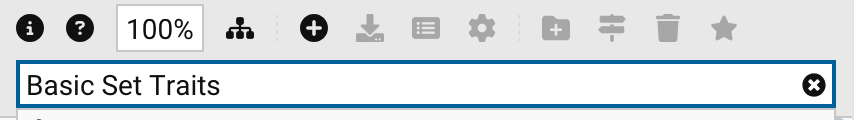
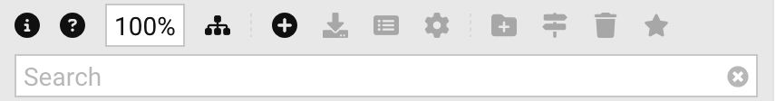

# Library Explorer

In GCS, **libraries** hold all the traits, skills, spells, equipment, and other content you'll add to your [character
sheet](Character%20Sheet%20Overview) to build characters.

- The **Master Library** comes with GCS and includes official GURPS content.
- The **User Library** is where you save and organize your own custom content.
- You can also mark **Favorites** to quickly open the files and folders you use most often.

All of these are available in the **Library Explorer** on the left sidebar of the GCS window.

To explore libraries:

- Select the arrows  to expand or collapse folders.
- Double-click a folder to open or close it.
- Select **Opens/closes all hierarchical rows**  on the toolbar to open
  or close all folders at once.

To open a file:

- Double-click it. The file opens in the **Document Workspace** as its own tab.

## Favorites

If you use a file or folder often, mark it as a **Favorite** so it's always at the top of the Library Explorer.

To create a favorite:

- Select the file or folder and select **Toggle Favorite**  on the toolbar,
  or
- Right-click it and select **Toggle Favorite**.

It now appears under **Favorites**, where a favorite folder shows its contents. To remove it, repeat the same steps,
either on the original or on its copy under Favorites.

> [!IMPORTANT]
> You can favorite files and folders inside a library, but not a whole library or individual items inside a file.

## Master Library

The **Master Library** is the built-in collection that comes with GCS. It includes hundreds of official traits, skills,
spells, and equipment taken from GURPS books and other supplements. Many items include notes and explanations, and when
added to your sheet they automatically adjust your stats and [points](Character%20points) for you.

> [!TIP]
> Use the **Search** field on the toolbar to find files by name. As you type, the matching folders and files are listed
> below the field, each with its icon and location. Choose one with a click, or with the arrow keys and `Return`, to
> select it in the tree. Press `Escape` to hide the list.
>
> 
>
> You can also search for individual items within files by checking the file types to search under **Deep search** in
> [General Settings](General%20Settings). A file that matched on its contents opens with the search text already in its
> own search field when you double-click it.

The Master Library is updated regularly. You can see the current version number next to its name (for example, _v5.16_).
By default, GCS checks for library updates each time it launches. You can change how often it checks with the **Check
for Library Updates** option in [General Settings](General%20Settings).

To update the Master Library:

- Select the Master Library, then select **Update**  on the toolbar, or select
  the **Update** button that appears beside its name when a new version is available. A progress bar shows the download
  and installation, and **Cancel** stops the update and leaves the library as it was.
- To see what's new, select **Release Notes** .

> [!CAUTION]
> **Do not** make changes directly in the Master Library. Updates replace the entire library, and your edits will be
> lost. If you want to customize something, copy it into your User Library first.

By default, content from the Master Library is saved in: `<home directory> > GCS > Master Library`.

### Library list toolbar

When you open a list file from a library, such as _Basic Set Traits_, its toolbar gives you tools to find things in it:

| Button                                               | Name                                                 | Description                                                                                                                                                                       |
|:-----------------------------------------------------|------------------------------------------------------|-----------------------------------------------------------------------------------------------------------------------------------------------------------------------------------|
| 100%                                                 | **Scale**                                            | Change the display size of the list.                                                                                                                                              |
|      | **Opens/closes all hierarchical rows**               | Show or hide all items within containers at once.                                                                                                                                 |
|  | **Opens/closes all embedded notes**                  | Show or hide all embedded notes.                                                                                                                                                  |
|        | **Sets the width of each column to fit its contents** | Resize every column to fit what it holds.                                                                                                                                        |
| N/A                                                  | **Quick Filter**                                     | Type to show only the rows whose text, in any column including the tags, contains what you type.                                                                                  |
| **Any Tag**          | **Tag Filter**                                       | Show only the items carrying the chosen [tags](Tags). Shift-click, or `Ctrl`-click (`Cmd`-click on macOS), to choose several.                                                     |
| **No Filter**  | **Saved Filters**                                    | Choose a [saved filter](Saved%20Filters) to narrow the list by any of its fields, or create, edit, and delete saved filters.                                                     |

While a list is filtered, a striped banner notes that items can't be added, removed, or rearranged until the filter is
cleared.

## User Library

The **User Library** is your personal space for [custom content](Custom%20Content). It’s where you keep anything that
belongs to _you_ rather than the official Master Library, such as:

- Saved [character sheets](Character%20Sheet%20Overview), [templates](Character%20Templates), and [loot
  sheets](Loot%20Sheets)
- Homebrew traits, skills, spells, or equipment
- [Notes](Notes) and [Markdown](Markdown%20Guide) documents related to your character or game
- Your own ancestries and [name generators](Name%20Generators)
- Anything you don’t want to lose when GCS updates

By default, your User Library is saved in: `<home directory> > GCS > User Library`.

Anything saved here will not change when the Master Library updates.

> [!TIP]
> Right-click a library, folder, or file and select **Show on Disk** to open its location on your computer.

### Creating or Importing Libraries

You can create your own list files or add whole libraries, including ones shared on GitHub.

- **Create a new list file:** Go to **File > New** and choose the type (for example, **New Traits Library**, **New
  Skills Library**, or **New Equipment Library**). GCS opens a new, empty list for you to add [custom
  content](Custom%20Content) to. Save it into your User Library and it appears in the Library Explorer.
- **Import an existing file:** If you’ve downloaded a file (or received one from another player), select **File >
  Open**, choose the file, and then save it into your User Library.
- **Add another library:** Select **Add Library**  on the toolbar. Give it a **Name**
  and a **Path** on your computer, and, for a library published on GitHub, the **GitHub Account** and **Repository** it
  comes from. GCS then offers updates for it just as it does for the Master Library. Select **Configure**
   to change these settings later.

### Organizing files

- **New folder:** Select a folder or library, then select **New Folder** 
  on the toolbar and enter a name.
- **Rename:** Select a file or folder, then select **Rename**  and enter the new
  name. Open documents follow the rename.
- **Move:** Drag files and folders to another folder, or use your computer's file manager. The Library Explorer notices
  changes made outside GCS.

### Deleting Libraries and Files

> [!CAUTION]
> When you delete a file or folder, GCS **permanently deletes** it from your computer, not just from the Library
> Explorer. Removing a library you added only removes it from the list and leaves its files on disk.

To delete a file or folder:

- Select it and select **Delete**  on the toolbar, press the `Delete` key, or
- Right-click it and select **Delete**.

## Library Explorer toolbar

The toolbar above the Library Explorer gives you quick access to common actions depending on what's selected:

| Button                                                | Name                                   | Description                                                                                                        |
|-------------------------------------------------------|----------------------------------------|--------------------------------------------------------------------------------------------------------------------|
|                     | **Help**                               | Open this page from the User Guide.                                                                                |
| 100%                                                  | **Scale**                              | Change the text size in the Library Explorer.                                                                      |
|       | **Opens/closes all hierarchical rows** | Show or hide all folders at once.                                                                                  |
|               | **Add Library**                        | Add a library from a folder on your computer or a GitHub repository.                                               |
|               | **Update**                             | Replace the selected library with its latest release.                                                              |
|    | **Release Notes**                      | See what’s new in the selected library's releases.                                                                 |
|           | **Configure**                          | Change the name, location, or GitHub settings of the selected library.                                             |
|          | **New Folder**                         | Create a new folder to organize files.                                                                             |
|                   | **Rename**                             | Rename the selected file or folder.                                                                                |
|                 | **Delete**                             | Permanently delete the selected files or folders from your computer, or remove an added library from the list.    |
|             | **Toggle Favorite**                    | Add or remove the selected files and folders from Favorites.                                                       |
|      | **Software Update Available**          | Appears only when a new version of GCS is available. See [Installing and Updating GCS](Installing%20and%20Updating%20GCS). |
| N/A                                                   | **Search**                             | Find files by name, or by their contents with **Deep search** turned on.                                           |

## File types

Each file type in GCS has its own extension and icon. Here’s what you’ll see in the Library Explorer:

| File type                  | Icon                                                              | Extension(s)                                      | Description                                                                                           |
|----------------------------|-------------------------------------------------------------------|---------------------------------------------------|-------------------------------------------------------------------------------------------------------|
| **Character Sheet**        |                  | `.gcs`                                            | Complete characters you build and play. See [Character Sheet Overview](Character%20Sheet%20Overview). |
| **Character Template**     |                      | `.gct`                                            | Templates you can reuse for new characters. See [Character templates](Character%20Templates).         |
| **Loot Sheet**             |                                 | `.loot`                                           | Lists to track [Loot](Loot%20Sheets) obtained during play.                                            |
| **Traits**                 |                           | `.adq`                                            | [Traits](Traits), including advantages, disadvantages, and quirks.                                    |
| **Trait Modifiers**        |         | `.adm`                                            | [Trait Modifiers](Trait%20Modifiers).                                                                 |
| **Skills**                 |                          | `.skl`                                            | [Skills](Skills) and techniques.                                                                      |
| **Spells**                 |                             | `.spl`                                            | [Spells](Spells).                                                                                     |
| **Equipment**              |                    | `.eqp`                                            | [Equipment](Equipment).                                                                               |
| **Equipment Modifiers**    |  | `.eqm`                                            | [Equipment Modifiers](Equipment%20Modifiers).                                                         |
| **Notes**                  |                            | `.not`                                            | [Notes](Notes).                                                                                       |
| **Ancestry**               |                         | `.ancestry`                                       | The random names, genders, ages, heights, weights, and looks of an ancestry. Opens in the ancestry editor. See [Name Generators](Name%20Generators). |
| **Name Generator**         |                     | `.names`                                          | A generator of random names for ancestries. Opens in the name generator editor. See [Name Generators](Name%20Generators). |
| **Markdown**               |                | `.md`                                             | Documents written in [Markdown](Markdown%20Guide) format.                                             |
| **PDF**                    |                          | `.pdf`                                            | PDFs, opened in the built-in viewer or your [external viewer](General%20Settings).                    |
| **Image**                  |                      | `.png`, `.jpg`, `.gif`, `.webp`, `.bmp`, `.svg`   | Images or graphics.                                                                                   |

Settings files, such as exported attributes, body types, and saved filters, live in each library's `Settings` folder.
They aren't shown in the Library Explorer, but the settings views that use them list them in their **Menu**
. Export templates live in the `Output Templates` folder and appear under **File >
Export**.

## Library Settings

Most players won’t need this, but advanced users can connect a library to a GitHub repository to share content with
others. Select a library and choose **Configure**  to set its **GitHub
Account**, **Repository**, and, for private repositories, a read-only **GitHub Access Token**. GCS then scans the
repository for release tags and offers them as updates. Check **Use the most recent commit (possibly unreleased) of
this repository** to follow the repository's latest commit instead of its releases.

---

[Return to Home](Home)
