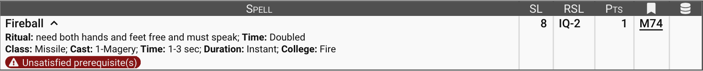
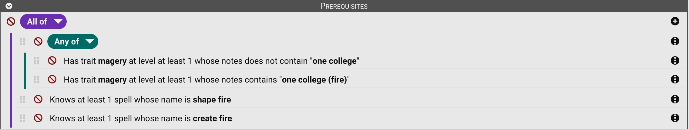

# Prerequisites

Prerequisites appear in the **Detail Editor** of [Traits](Traits), [Skills](Skills), [Spells](Spells), and
[Equipment](Equipment). They define the requirements your character must meet before taking or using the item.

## Unmet prerequisites

If you add something to your [character sheet](Character%20Sheet%20Overview) without meeting its requirements, GCS
tags it with **Unsatisfied prerequisite(s)**.

Hover over the tag to see what's missing. Each missing requirement is described in plain language, under headings such
as _Requires all of:_ or _Requires at least one of:_ where they add something.

> [!TIP]
> By default an item with unmet prerequisites still counts: a trait still gives its features and costs its points. Turn
> on **Disable traits whose prerequisites are unsatisfied** in [Sheet Settings](Sheet%20Settings) to treat such a trait
> as disabled until its prerequisites are met. Traits whose prerequisites contradict each other (for example, two
> traits that each require the other's absence) are left enabled and tagged **Contradictory prerequisite(s)**.

## The Prerequisites section

In the editor, the **Prerequisites** section lists each requirement as a line of plain text, such as _Has trait Magery
at level at least 1_. Select the section's title to collapse it to a one-paragraph summary, or to expand it again.

- **Groups:** Requirements hang from a colored line beneath a group pill. Select the pill to choose how the group
  combines what it holds:
  - **All of:** everything in the group must be met.
  - **Any of:** at least one requirement in the group must be met.
  - **None of:** nothing in the group may be met.
  - **Not all of:** at least one requirement in the group must not be met.
- **Editing:** Select a requirement to open it. Its controls read as a sentence; change the dropdowns and fields, then
  select **Done** (or press `Return` or `Escape`) to close it.
- **Chips:** Optional criteria, such as a level or a specialization, are added as chips. Select a dashed **+ …** button
  to add one, and the **x** on a chip to remove it.
- **Reordering:** Drag a requirement by its grip  to move it within or between
  groups. Dragging it into the Prerequisites section of another open editor copies it there.
- **More actions:** Select **More actions**  beside a requirement for
  **Duplicate**, **Move Up**, **Move Down**, **Wrap in Group**, **Ungroup**, and **Delete**.

Every change can be undone with **Edit > Undo**.

When the item is on a character sheet, each requirement and group shows whether the character meets it:

| Mark                                                  | Meaning                                                                                                                               |
|-------------------------------------------------------|---------------------------------------------------------------------------------------------------------------------------------------|
|              | **Met.**                                                                                                                              |
|        | **Not met.** Hover over it to see what's missing.                                                                                     |
|   | The requirement couldn't be checked, such as a script with an error in it.                                                            |
|         | Left out of the check: an empty group, or one whose tech level condition doesn't match the character's.                               |

The colors of these marks and of the group pills can be changed in [Colors and Fonts](Colors%20and%20Fonts).

## Adding prerequisites

To add a prerequisite:

1. Open the **Detail Editor** for the trait, skill, spell, or equipment.
2. In the **Prerequisites** section, select **Add**  beside the group you want to add
   to. When the section is empty, you can also select **No prerequisites. Click here to add one.**
3. Choose the kind of requirement (see **Requirement types** below), or one of the **Structure** items:
   - **All of Group** or **Any of Group** adds a nested group. See **Groups** below.
   - **Only When TL…** adds a tech level condition to the group. The group is only checked when the character's TL
     matches it (_is_, _is not_, _is at least_, or _is at most_ a given TL).

To delete a requirement:

- Select **More actions**  beside it, then **Delete**.

> [!WARNING]
> When typing names (traits, skills, spells, equipment), you must match the name **exactly** as it appears in the
> library or on your sheet. Typos or mismatches mean the prerequisite won’t be recognized. Comparisons ignore case.

The choices you make when adding a prerequisite are defined by two parts:

- The **operator** (how the rule is compared).
- The **target** (what the rule applies to).

## Operators

Operators define how the prerequisite is checked. These appear in dropdowns when you select how to compare values.

Some are for numbers, others for text. The available operators depend on the type of field (text vs. numeric) and
target. In fields that take tags, colleges, or damage types, you can list several separated by commas (for example,
`Sword, Axe`) to match any one of them.

See [Operators](Operators) for a full list.

## Requirement types

The requirement types define what the prerequisite applies to. The fields you see depend on the type you choose.

Most requirements begin with **Has** or **Doesn't have**, then define what that applies to.

### Trait

Requires that a character **has** or **doesn't have** a trait.

- **Name:** Compare the trait name (_is_, _is not_, _contains_, _starts with_, _ends with_). Enter the name in the text
  field.
- **+ level:** Compare the trait's level (_is at least_, _is at most_).
- **+ points:** Compare the trait's total point cost.
- **+ tag:** Require a [tag](Tags).
- **+ notes:** Compare the trait's notes.
- **+ modifier name**, **+ modifier notes**, **+ modifier tag:** Require that one of the trait's enabled [Trait
  Modifiers](Trait%20Modifiers) matches all of the modifier criteria.
- **+ title note:** Compare the text shown in parentheses after the trait's name.

### Attribute

Requires that an attribute **is**, **is not**, **is at least**, or **is at most** a value.

- **Attribute:** Choose from the sheet's attributes (for example, ST, DX, Will, Vision), or **Size Modifier** or
  **Dodge**.
- **+ combined with:** Optionally add a second attribute and compare the total (for example, ST+DX).

### Equipped equipment

Requires that a character **has** or **doesn't have** a specific piece of equipment equipped.

- **Name:** Compare the equipment name. Enter the name in the text field.
- **+ tag:** Require a [tag](Tags).
- **+ modifier name**, **+ modifier notes**, **+ modifier tag:** Require that one of the item's enabled [Equipment
  Modifiers](Equipment%20Modifiers) matches.
- **+ title note:** Compare the text shown in parentheses after the item's name.

### Carried equipment

Requires that a character **has** or **doesn't have** a piece of equipment that is carried but not equipped, such as
a toolkit in a pack. It offers the same criteria as **Equipped equipment**.

### Skill

Requires that a character **has** or **doesn't have** a skill. A skill with no points in it doesn't count, even when it
has a level from one of its defaults.

- **Name:** Compare the skill name. Enter the name in the text field.
- **+ specialization**, **+ optional specialization:** Compare the skill's specializations.
- **+ level:** Compare the skill's level (_is at least_, _is at most_).
- **+ points:** Compare the points spent on the skill.
- **+ tag:** Require a [tag](Tags).
- **+ title note:** Compare the text shown in parentheses after the skill's name.

### Spell

Requires that a character **knows** or **doesn't know** a number of spells (_exactly_, _not_, _at least_, or _at most_)
that match:

- **whose name:** Spells with a matching name.
- **with a tag which:** Spells carrying a matching [tag](Tags).
- **with a title note which:** Spells whose title note matches.
- **whose college name:** Spells from a matching college.
- **from … college(s):** Spells from a number of different colleges.
- **of any kind:** Any spells.

Add **+ power source** to count only spells from a given power source ([B77](B77)); in a spell's own editor it defaults
to the same power source as the spell. Add **+ level** to count only spells at a given level. A spell that itself
requires the spell being checked isn't counted.

### Contained quantity and contained weight

Available for [Equipment](Equipment) only. Require that a [container](Containers) holds a quantity of items, or a weight
of contents, that is _exactly_, _not_, _at least_, or _at most_ a value.

### Script

Runs a custom script to check the prerequisite. See the [Scripting Guide](Scripting%20Guide).

- Enter a **Description** of the requirement, such as _DX + Per totals at least 26_. This is what the editor and the
  unmet prerequisites tooltip show for it. Without one, the requirement is called _A custom check_.
- The script's last value decides the result: `true` or empty text means the requirement is met; `false` means it
  isn't; any other text means it isn't, with that text shown as the reason.
- When the item is on a character sheet, the result of running the script against the character is shown beneath the
  script, updated as you type.

> [!IMPORTANT]
> Scripts are evaluated much more slowly than other prerequisite types. Use this option only when no other type can
> model the requirement.

## Groups

A group is a **set of requirements nested inside another**. Use them to build complex conditions.

- Every group has a pill that reads **All of**, **Any of**, **None of**, or **Not all of**.
- Inside the group, you can add any number of requirements (traits, attributes, skills, etc.).
- Groups can be nested inside each other for very complex logic.
- A group with nothing in it, or whose **Only When TL…** condition doesn't match the character, is left out of the
  check.

**_Example:_** Requires ST 12+ **and one of** (Magery 1, Power Investiture 1, **or** Gadgeteer).

> [!TIP]
> Use groups when you want **multiple ways** to qualify for something, or when a rule requires **several conditions at
> once.** Select **Wrap in Group** from a requirement's **More actions** menu to put it in a new group, and
> **Ungroup** to dissolve a group into its parent.

## Saving prerequisites

On the Detail Editor toolbar:

- **Apply changes**: Select **Apply Changes**  to save.
- **Discard changes**: Select **Discard Changes**  to exit
  without saving.

---

[Return to Home](Home)
