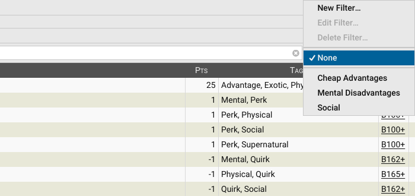
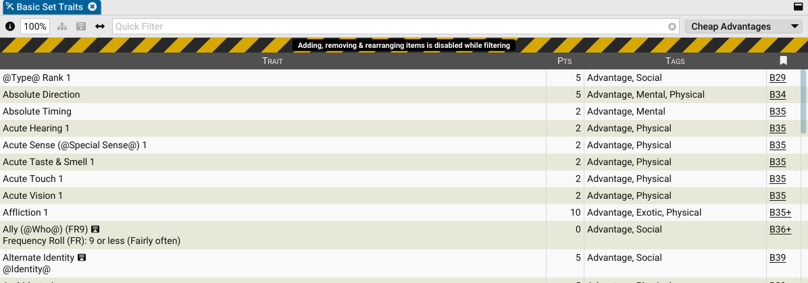
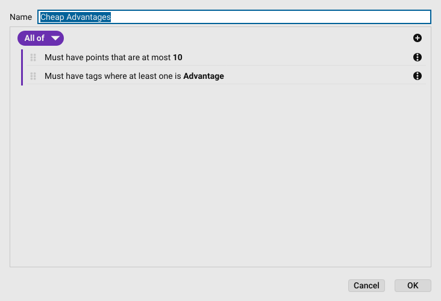
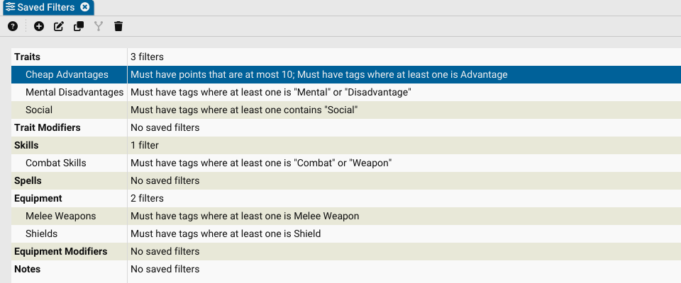
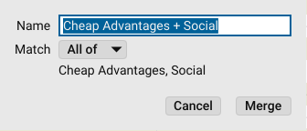
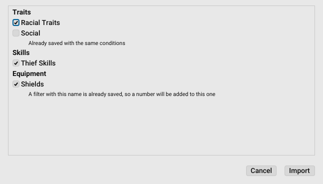

# Saved Filters

A **saved filter** is a named set of conditions that narrows a library list to the items that match it. For example,
_Cheap Advantages_ could show only the traits tagged `Advantage` that cost 10 points or less.

Saved filters belong to a list type (traits, trait modifiers, skills, spells, equipment, equipment modifiers or
notes), and every library list of that type offers them. They are stored in your GCS settings, not in your libraries,
so they are available whichever library file you open.

## Using a saved filter

Each library list has a saved filter dropdown at the right end of its toolbar.

- Select a filter to show only the items that match it.
- Select **None** to show every item again.
- Select **New Filter…**, **Edit Filter…** or **Delete Filter…** to manage filters without leaving the list. Edit and
  delete act on the filter currently in use.

While a filter is in use, a striped banner runs across the top of the list. Containers that hold a matching item stay
visible, dimmed, so you can see where the item sits. The **Quick Filter** field still works, and narrows the results
further.

> [!NOTE]
> Adding, removing and rearranging items is disabled while a list is filtered. Select **None** and clear the Quick
> Filter to make those changes.

## Building a filter

The filter editor describes each condition as a plain sentence, such as _Must have tags where at least one is
Advantage_.

- **Name:** Each filter needs a name that no other filter of the same list type uses, ignoring case.
- **Conditions:** Select **Add**  to add a condition or a group. Select a condition's
  sentence to change it.
- **Groups:** The pill at the top of a group sets how it combines what it holds:
  - **All of:** everything in the group must match.
  - **Any of:** at least one thing in the group must match.
  - **None of:** nothing in the group may match.
  - **Not all of:** at least one thing in the group must not match.
- **Order:** Drag a row by its grip to move it.

A filter can't be saved until it has a name and at least one condition.

## Managing saved filters

To see and manage every saved filter in one place:

- Go to **Settings > Saved Filters…**.

The filters are listed under their list type, with a summary of each filter's conditions.

Select one or more filters, then use the toolbar. Right-click a filter for the same commands.

- **New Filter** : Choose a list type, then build the filter in the editor.
- **Edit Filter** : Open the selected filter in the editor. Double-clicking a filter
  does the same.
- **Duplicate** : Copy each selected filter. A copy is named after its source, such
  as _Social (2)_.
- **Merge** : Combine two or more filters of the same list type into a new one.
- **Delete** : Delete the selected filters.

Every change can be undone with **Edit > Undo**, including a change made from a list's saved filter dropdown while the
Saved Filters settings are open.

### Merging filters

Merging creates a new filter that combines the selected filters. The originals are kept.

- **Name:** The name for the new filter.
- **Match:** Choose **All of** to require every original filter to match, or **Any of** to require at least one.

You can open the merged filter in the editor afterwards to adjust it.

## Sharing saved filters

Saved filters can be exported to a `.filters` file and imported from one, to share them with your group or move them
to another computer. Select **Menu**  on the Saved Filters toolbar:

- **Import…:** Choose a `.filters` file to import from.
- **Export All…:** Save every saved filter to a file.
- **Export Selected…:** Save only the selected filters to a file.

Before anything is imported, GCS lists the filters in the file by list type so you can choose which ones to keep.
Filters with no conditions are left out.

- A filter you already have, with the same name and the same conditions, is left unchecked.
- A filter whose name is already in use, with different conditions, is imported with a number added to its name, such
  as _Shields (2)_.

> [!TIP]
> Put a `.filters` file in the `Settings` folder of any library, such as your User Library, and it appears at the
> bottom of the Saved Filters menu, ready to import without browsing for it.
