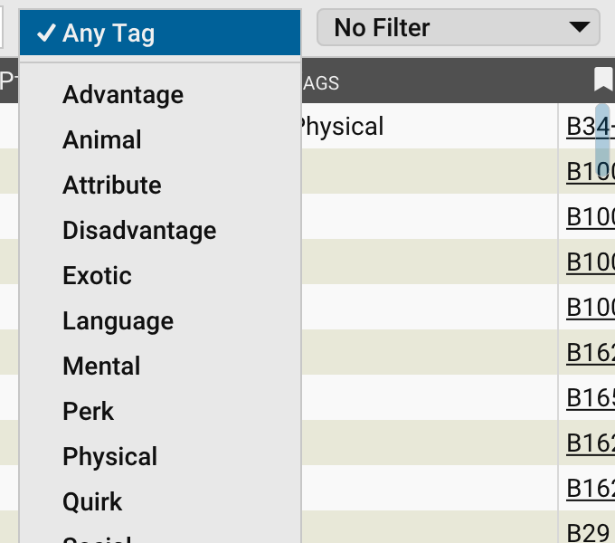

# Tags

**Tags** are short labels used to **categorize and filter items** across libraries and character sheets. You can assign
tags to [Traits](Traits), [Skills](Skills), [Spells](Spells), [Equipment](Equipment), [Notes](Notes), and
[modifiers](Trait%20Modifiers).

Tags make it easier to find related content in large libraries or when filtering by type. For example, viewing only
_Melee Weapons_ or _Social Skills_.

## How tags work

Tags are:

- **Case insensitive when matched:** `Combat` and `combat` find the same items, though the tag keeps the case you
  typed.
- **Comma-separated:** You can assign multiple tags to the same item (for example, `Physical, Athletic, Combat`). GCS
  keeps them sorted.
- **User editable:** You can create your own tags for campaign-specific content or house rules.
- **Searchable and filterable:** In any library list, use the **Tag Filter** dropdown to show only items with the tags
  you choose, or build a [saved filter](Saved%20Filters) that tests the tags along with other fields.
- **Used by rules:** [Features](Features), [Prerequisites](Prerequisites), and [Defaults](Defaults) can select items
  by tag, so a bonus can apply to every skill tagged `Combat` or a default can draw on any skill tagged `Melee Combat`.
  Equipment tagged `Money` is what a character pays with when buying [Equipment](Equipment).

## Adding and editing tags

To add or edit tags:

1. Open the item in its editor (for example, a trait or skill).
2. In the **Tags** field, enter one or more tags separated by commas.
3. Save your changes.

Once tags are added, you can use them to quickly group or search items across your libraries.

## Using tags in libraries

The **Tag Filter** dropdown on a library list's toolbar, labeled **Any Tag** until a tag is chosen, lets you filter
content by tag.

- Select a tag to show only items that carry it. Shift-click, or `Ctrl`-click (`Cmd`-click on macOS), to choose
  several tags; an item must carry every chosen tag to be shown.
- Select **Any Tag** to clear the selection and show all items again.
- Select **Save Filter…** to turn the chosen tags, together with the current saved filter, into a new [saved
  filter](Saved%20Filters).

The tags offered are those of the items the current saved filter lets through, so they change depending on the list
you are browsing. Choosing another saved filter clears the chosen tags.

For example:

- Filter traits by `Advantage` or `Social` to narrow down your options.
- Filter skills by `Combat`, `Social`, or `Technical`.
- Filter equipment by `Weapon`, `Armor`, or `Tools`.

## Tag conventions

While you can create any tags you like, following common conventions helps keep things consistent, especially if you
plan to [contribute to the Master Library](Contributing%20to%20the%20Master%20Library).

Here are some general patterns used in libraries:

- **Traits:** Use broad categories like `Advantage`, `Disadvantage`, `Perk`, `Quirk`, `Physical`, `Mental`, `Social`,
  `Supernatural`. **Sheet > Organize Traits** uses these to file traits into containers.
- **Skills:** Tag by purpose or domain, such as `Combat`, `Social`, `Technical`, `Scholarly`, `Outdoor`, or `Cinematic
  Techniques`.
- **Spells:** Tag by college, such as `Air`, `Fire`, or `Mind Control`.
- **Equipment:** Tag by type or use, such as `Weapon`, `Shield`, `Armor`, `Medical Gear`, `Ammunition`, or `Tools`.
  - Some equipment also uses tags to identify which ammo the weapon uses, like `AmmoType:Arrow` or
    `UsesAmmoType:Sling`.
  - Coins are tagged `Money`, so characters can spend them.

> [!TIP]
> Consistent tag names make filtering and searching more powerful. Consider matching the tags already used in the Master
> Library when adding new items.

---

[Return to Home](Home)
