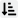

# Trait Modifiers

**Trait Modifiers** ([B101](B101)) can be applied to [Traits](Traits) as either **enhancements** or **limitations**.
These adjust the base cost of a trait, and can carry [Features](Features) of their own.

## Master Library

GCS includes libraries of official trait modifiers in the **Master Library** that are taken from GURPS books and other
supplements. See [Library Explorer](Library%20Explorer) for more details.

You can also create your own custom trait modifiers.

## Trait Modifier list

The **Trait Modifier** table in the Trait Editor includes the following columns. Select a column heading to sort
ascending  or descending .

| Column                                                | Description                                                                                                                                                         |
|-------------------------------------------------------|---------------------------------------------------------------------------------------------------------------------------------------------------------------------|
|          | If checked, the modifier is **enabled** and its effects apply to the trait.                                                                                         |
| **Trait Modifier**                                    | The modifier’s name and any notes. Select the chevron  to show or hide the notes.                                  |
| **Cost Adjustment**                                   | The calculated adjustment to the trait’s [character point](Character%20points) cost.                                                                                |
| **Tags**                                              | Tags used to help organize modifiers.                                                                                                                               |
|  | Page reference for the modifier. See [Page References](Page%20References).                                                                                          |
|                 | Tracks whether the modifier matches the library it came from. See _Master Library Syncing_ in [Character Sheet Overview](Character%20Sheet%20Overview).            |

## Adding trait modifiers

You must add modifiers to an existing [Trait](Traits).

To add a modifier from a library:

1. Open the **Trait Editor** for the trait you want to modify.
2. Open a trait modifiers list from the **Master Library**.
3. Drag the modifier to the **Trait Modifier** table in the editor.

To add modifiers without dragging:

1. Select the modifiers in a trait modifiers list.
2. Go to **Item > Apply Modifier**, or right-click and select **Apply Modifier**.
3. Choose the open sheet, template, or list, then the traits that should receive them. Each receives its own copy of
   the modifiers, enabled.

You can also drop modifiers straight onto traits in a list on your sheet. Dropping onto one of several selected traits
adds the modifier to all of them.

To create a new custom modifier:

- Open the Trait Editor for the trait you want to modify.
- Go to **Insert > Trait > New Trait Modifier** (`Ctrl+Alt+M` / `Cmd+Option+M`), or right-click the Trait Modifier
  table and select **New Trait Modifier**.

> [!NOTE]
> When you first add a trait that has modifiers to a sheet, GCS prompts you to select them. You can select one,
> several, or none, and a choice marked **Pick 1** must be made. If you skip this step, you can add or edit modifiers
> later in the **Trait Editor**.

## Modifier groups and choices

Modifiers can be organized into containers:

- A **group** just organizes modifiers. Add one with **Insert > Trait > New Trait Modifier Group**.
- A **choice** makes its modifiers exclusive, and shows a **Pick 1** or **Pick at most 1** tag in the table. A
  _mandatory_ choice asks for exactly one of its modifiers, such as the one that sets the price of a trait whose cost
  varies; an _optional_ choice asks for at most one. Turning one of the modifiers on turns off the one that was on.
  Add one with **Insert > Trait > New Trait Modifier Choice**, or turn a group into one with **Item > Convert > Convert
  to Choice**.

On a character sheet, a mandatory choice always needs its pick, which can be changed but not turned off. A trait whose
mandatory choice has no pick is tagged **Modifier choice required**. In a template or library, the pick is only a
default, and the trait's cost shows as a range until it reaches a sheet and the choice is made.

## Managing modifiers

You can manage modifiers directly in the Trait Editor:

- **Enable/disable:** Check or uncheck the box to apply or remove a modifier’s effects. You can also select modifiers
  and use **Item > Toggle State** (`Ctrl+'` / `Cmd+'`) to flip several at once.
- **Reorder:** Drag modifiers, or use the **Item > Move** commands.
- **Delete:** Select the modifier and choose **Edit > Delete**, or right-click it and select **Delete**.

> [!TIP]
> Some modifiers include [substitution **placeholders**](Substitutions) (for example, `@Condition@`). You can set these
> when first adding the modifier, or later with **Set Substitutions** 
> in the trait's editor. A modifier can share its answer with the trait it belongs to, so the player is only asked once.

## Editing trait modifiers

You can edit a trait modifier in a few ways:

- Double-click it to open the **Trait Modifier Editor**.
- Right-click it and select **Open Detail Editor**.
- Select a trait modifier and go to **Item > Open Detail Editor**.

Save your changes when you're done from the **Trait Modifier Editor toolbar** (see below). The modifier editor is
titled for the modifier, such as _Trait Modifier Editor for Long Claws_.

## Trait Modifier Editor fields

The Trait Modifier Editor includes the following fields:

| Trait Modifier field              | Description                                                                                                                                                                                                                   |
|-----------------------------------|-------------------------------------------------------------------------------------------------------------------------------------------------------------------------------------------------------------------------------|
| **Name**                          | The trait modifier's name.                                                                                                                                                                                                    |
| **Show in title notes**           | If checked, the modifier is listed in parentheses after the trait's name, instead of in the trait's notes.                                                                                                                    |
| **Notes**                         | Notes about what the trait modifier does. These appear with the trait on your character sheet. Supports [Markdown](Markdown%20Guide).                                                                                        |
| **Show notes in owner's notes**   | If checked (the default), the modifier's notes appear in the trait's notes. Clear it to list the modifier by name only.                                                                                                       |
| **Show notes in attack usage**    | If checked, the notes also appear in the usage notes of the trait's attacks.                                                                                                                                                  |
| **VTT Notes**                     | Notes for use in your Virtual Tabletop system. See your VTT’s documentation.                                                                                                                                                  |
| **Enabled**                       | If checked, the modifier is active and applies its effects. The pick of a mandatory choice on a sheet can't be turned off.                                                                                                   |
| **Cost**                          | The modifier’s cost: a percentage (`+50%`, `-25%`), a flat point cost (`+5`, `-5`), or a multiplier (`x2`, `x2/3`). Choose whether it applies **to cost**, **to base cost only**, or **to leveled cost only**.                |
| **Level**                         | The level of the modifier, if applicable.                                                                                                                                                                                     |
| **Use level from owner**          | If checked, the modifier’s level is linked to the parent trait’s level.                                                                                                                                                       |
| **Multiply cost by level**        | If checked (the default), a leveled modifier's cost adjustment is multiplied by its level. Clear it to apply the cost once while any per-level [features](Features) the modifier carries still scale with the level.         |
| **Total**                         | Read-only. The total calculated cost adjustment from this modifier.                                                                                                                                                           |
| **Tags**                          | Comma-separated tags to help organize modifiers.                                                                                                                                                                              |
| **Page Reference**                | Page number for the modifier. See [Page References](Page%20References) for details.                                                                                                                                           |
| **Page Highlight**                | Text to highlight in the PDF. Leave blank unless the default highlights fail.                                                                                                                                                 |
| **Nameables**                     | Defines the `@code@` placeholders the modifier uses, and shows which are defined by the trait it belongs to. See [Substitutions](Substitutions).                                                                              |
| **Features**                      | Lists attribute, condition, skill, spell, reaction, or attack changes applied by the modifier, and anything it grants. See [Features](Features) for more details.                                                             |

A modifier group or choice has only **Name**, **Notes**, **Tags**, **Page Reference**, and **Page Highlight**, plus a
**Choice** setting (**Mandatory: exactly one must be picked** or **Optional: at most one may be picked**) for a
choice.

## Trait Modifier Editor toolbar

The toolbar above the Trait Modifier Editor gives you quick access to common actions:

| Button                                                  | Name                    | Description                                                                                             |
|---------------------------------------------------------|-------------------------|---------------------------------------------------------------------------------------------------------|
|                       | **Help**                | Opens this page from the User Guide.                                                                    |
| 100%                                                    | **Scale**               | Adjusts the display size of the Trait Modifier Editor.                                                  |
|      | **Apply Changes**       | Saves and closes the Trait Modifier Editor (`Ctrl+Return` / `Cmd+Return`).                              |
|  | **Discard Changes**     | Exits without saving changes (`Escape`).                                                                |
|                   | **ID & Library Source** | Shows the modifier's ID and library source, and offers **Sync with Source** and **Clear Source**.       |

---

[Return to Home](Home)
