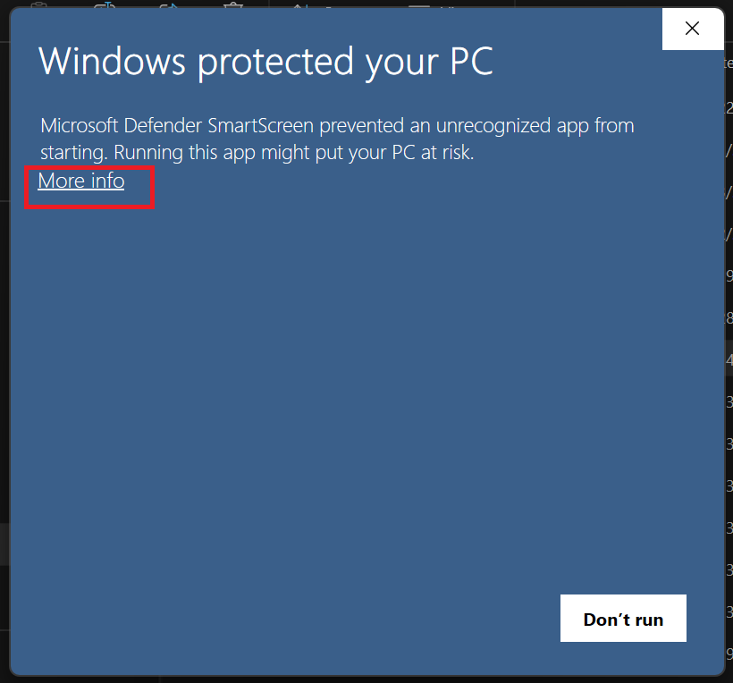
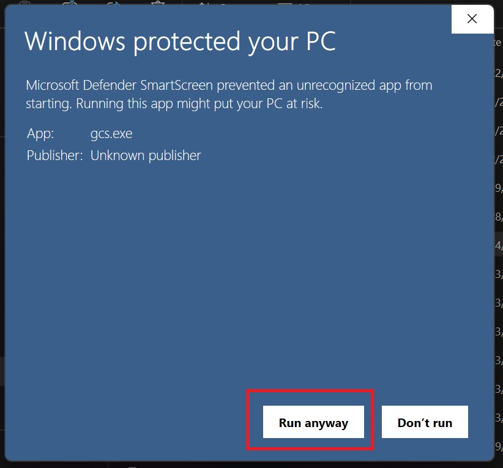

# Troubleshooting

This section lists common problems you might run into while using GCS, along with their causes and how to fix them.

## General Troubleshooting Steps

Before trying the issue-specific fixes below, you may want to try these quick steps. They solve many common problems:

1. **Restart GCS:** Close the program completely and reopen it.
2. **Reboot your computer:** A fresh start often clears up stuck processes or memory issues.
3. **Check for updates:** Make sure you’re running the latest version of GCS and that your operating system is up to
   date. See [Installing and Updating GCS](Installing%20and%20Updating%20GCS).

> [!NOTE]
> If you don't see your issue listed here, you can:
>
> - Ask for help in the [GCS Discord community](https://discord.gg/MKhuDPPagY).
> - Report a bug or request a feature by [creating an issue on GitHub](https://github.com/richardwilkes/gcs/issues).
>   Attach the log file, and the `gcs-crash.log` file beside it if GCS crashed. The **Log Path** in [General
>   Settings](General%20Settings) shows where they are.

## List of common issues and steps to fix:

- Some windows or tabs are missing in GCS
- Page references open to the wrong page in a PDF
- "Windows protected your PC" warning appears when launching GCS
- GCS doesn't start, or no window appears
- GCS is very slow to start
- Character sheets appear smaller than expected
- A trait, skill, or spell shows an unsatisfied prerequisite that the character meets

---

## Issue: Some windows or tabs are missing in GCS

**Cause:** A window inside GCS has been maximized. When this happens, it fills the whole Document Workspace and hides
any other open windows or tabs.

**How to fix:**

1. Select **Restore**  on the **top-right corner** of the maximized
   window.
2. The window will shrink back to its normal size, and any other open windows or tabs will reappear.

---

## Issue: Page references open to the wrong page in a PDF

**Cause:** GCS opens PDFs by the page labels printed in the book, so most PDFs need no adjustment. Some PDFs number
their pages differently from the book, which shifts the page GCS opens to.

**How to fix:**

1. Go to **Settings > Page Reference Mappings**.
2. Update the **Page Offset** for the impacted PDF to match the difference. Use a positive offset if the PDF has extra
   pages at the beginning, or a negative offset if it starts later.

> **Example:** If selecting _B16_ opens your PDF to page 14, set the page offset to `+2` to account for the two-page
> difference.

If you set an offset for a PDF in a version of GCS before v5.47, which counted pages from the front of the file, you
may need to set it back to `0`.

See [Page References](Page%20References) for more details.

---

## Issue: “Windows protected your PC” warning appears when launching GCS

**Cause:** Windows Defender SmartScreen is blocking the app because it doesn’t recognize the publisher. This often
happens the first time you run new software that isn’t signed with a Microsoft certificate.

**How to fix:**

1. On the warning window, select **More info**.
2. Select **Run anyway**.
3. GCS will launch normally. You won’t see this warning again for that version.

> [!NOTE]
> This message may appear each time you [update](Installing%20and%20Updating%20GCS) GCS to a new version.

| Warning Window - More info                             | Warning Window - Run anyway                            |
|--------------------------------------------------------|--------------------------------------------------------|
|  |  |

---

## Issue: GCS doesn’t start, or no window appears

**Cause:** There are a few common reasons this can happen:

1. GCS may already be running in the background without a visible window.
2. Your graphics driver, or software that hooks into it, hangs when GCS asks for hardware-accelerated (OpenGL)
   drawing. GCS switches to drawing with the processor on its own when the driver reports a failure, but a driver that
   hangs instead gives it nothing to react to.

**How to fix:**

1. **Check for a hidden instance of GCS:**
   - Open **Task Manager** (or **Activity Monitor** on macOS) and look for “GCS” in the list of running applications.
   - If found, **End Task** and try launching GCS again. GCS gives up and quits on its own if its window hasn't
     appeared within two minutes, so a stuck copy won't linger for long.
2. **Bypass hardware-accelerated drawing:**
   - Set the `UNISON_CPU_RENDERING` environment variable to `1` before launching GCS. GCS then draws everything with
     the processor and never uses OpenGL. Drawing is slower this way, but the application runs.
   - Update your graphics drivers, then try again without the variable.

---

## Issue: GCS is very slow to start

**Cause:** A faulty input device driver (for example, certain headsets that incorrectly register as input devices), or a
graphics driver that is slow to respond, can delay GCS from opening its initial window. The first launch after an
update can also take a moment longer while GCS rebuilds its index of the fonts installed on your system.

**How to fix:**

1. If GCS takes several seconds or more to open every time, update or remove any suspicious device drivers. Known
   examples include USB headsets that appear as input devices without actually supporting input.
2. If a graphics driver is at fault, see the previous issue.

---

## Issue: Character sheets appear smaller than expected

**Cause:** If your primary monitor doesn’t correctly report its resolution, GCS may scale the interface incorrectly.
This issue is most common on **Windows systems** using custom display scaling or multiple monitors, but it can also
occur on **macOS** or **Linux** if the system’s display settings don’t match the physical monitor specs.

**How to fix:**

1. In GCS, go to **Settings > [General Settings](General%20Settings)**.
2. Find the **Monitor Resolution** field.
3. Enter the correct pixels per inch (PPI) for your primary monitor. You can use [this online
   calculator](https://www.sven.de/dpi/) to find your monitor’s PPI based on its resolution and size.
4. Restart GCS (your changes are saved automatically).

This forces GCS to use the correct scaling information and should restore the sheet to its normal size.

> [!TIP]
> **Windows:** Right-click your desktop, select **Display settings**, and check the **Display resolution** value under
> **Scale and layout**. If your **Scale** setting is higher than 100%, try reducing the **Monitor Resolution** value
> slightly in GCS.
>
> **macOS:** Go to **System Settings > Displays**, then check your **Resolution** and **Scale** options. Choose
> **Default for display** or **Scaled** and note the resolution used.
>
> **Linux:** Open your display settings (for example, **Settings > Displays** in GNOME) and confirm your **Resolution**
> and **Scale** values.

---

## Issue: A trait, skill, or spell shows an unsatisfied prerequisite that the character meets

**Cause:** The prerequisite names something slightly different from what the character has. Names must match exactly
(ignoring case), a skill with no points in it doesn't count as a skill the character has, and spell prerequisites only
count spells from the same power source.

**How to fix:**

1. Hover over the **Unsatisfied prerequisite(s)** tag to read exactly what is missing.
2. Open the item's editor and check its **Prerequisites** section. When the item is on a character sheet, each
   requirement is marked as met or not met, with a tooltip explaining why. See [Prerequisites](Prerequisites).
3. If the prerequisite is a script, the result of running it is shown beneath the script.

---

[Return to Home](Home)
